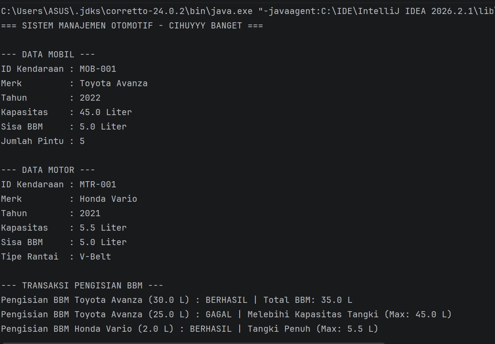
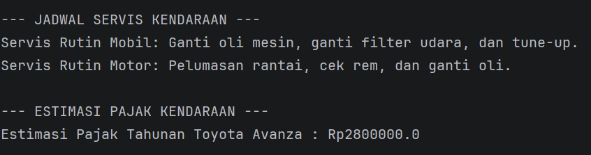

**Responsi Praktikum Pemrograman Berorientasi Objek**

Nama: Maulida Nur Hidayah

NIM: H1D025049

Shift KRS: B

Shift Sekarang: H-I

Tema: Otomotif 

**Cara menjalankan(run) dan compile program tersebut**
1. Buka project **Responsi PBO** di IntelliJ IDEA.
2. Buka file *Main.java* (di folder src dan masuk ke folder *Responsi PBO*).
3. Klik tombol Run (ikon segitiga hijau) di sebelah tulisannya *Current File*.
4. Maka keluar hasilnya 

**Compile**: Mengubah kode Java (`.java`) di folder `src` menjadi berkas bytecode (`.class`).
  ```bash
javac src/*.java
```

**(Output)**

Bagian 1:


Bagian 2:
